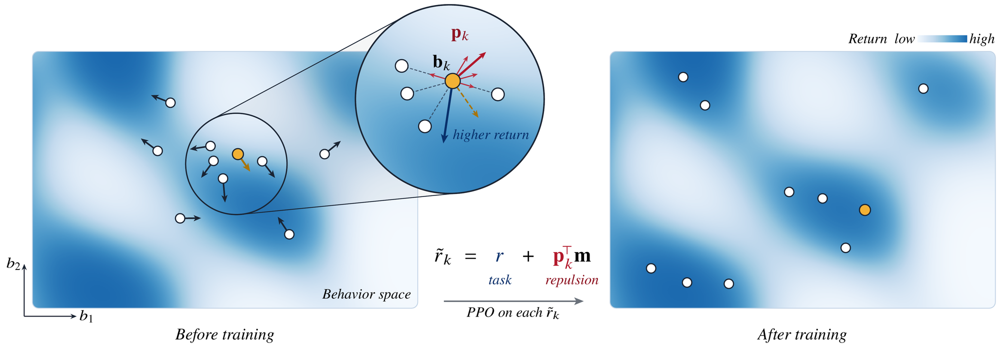

# RePPO: Repulsive Population Policy Gradients

Code for [**Repulsive Population Policy Gradients for Behaviorally Diverse Reinforcement Learning**](https://arxiv.org/abs/2610.36425).

[Paper](https://arxiv.org/abs/2610.36425) · [Project page](https://conflictednerd.github.io/reppo/)



RePPO trains a small population of policies that are both high-performing and behaviorally different. Each policy
runs ordinary PPO on a shaped reward

$$\tilde r_k = r + p_k^\top m,$$

where $m$ is a per-step behavior signal (e.g. foot contacts) and the diversity weights $p_k$ push policy $k$ away
from nearby high-quality members of the population. The weights come from the gradient of the Soft QD objective, so
quality and diversity are optimized jointly with standard RL updates: no archive and no evolutionary operators.
Setting $p_k = 0$ recovers independent PPO runs (Ind-PPO). If you train with PPO and want several distinct,
strong solutions under a behavior descriptor you can write as a per-step signal, RePPO is a small extension of it.

## Installation

Requires Python 3.10–3.12, a CUDA GPU, and [uv](https://docs.astral.sh/uv/).

```bash
uv sync                               # RePPO, Ind-PPO, Sep-CMA-MAE, pixels, LunarLander
uv sync --python 3.12 --extra atari   # Atari (EnvPool needs Python 3.12)
uv sync --extra ppga                  # PPGA
uv sync --extra pga_me                # PGA-ME and DCRL-ME (QDax)
uv sync --all-extras                  # everything
```

## Quick start

```bash
uv run python -m src.main env=humanoid seed=1 log_dir=outputs/humanoid_s1
uv run python scripts/evaluate_population.py --exp-dir outputs/humanoid_s1
```

Configs are in `conf/` (Hydra): `algorithm=reppo|reppo_atari|reppo_pixels`, `env=ant|halfcheetah|humanoid|walker2d|
atari_*|*_pixels|lunarlander`, and any setting can be overridden, e.g. `algorithm.C_max=0.5` or
`algorithm.force_c_zero=true` (Ind-PPO). Training writes checkpoints to `log_dir`; `evaluate_population.py`
re-evaluates the final population and writes `evaluation_results.json`.

## Reproducing the paper

Each script trains every method, task, and seed of one experiment and re-evaluates each run (256 episodes per policy,
32 full games on Atari).

| Experiment | Script | Paper |
|---|---|---|
| Continuous control, RePPO and Ind-PPO | `scripts/run_reppo.sh`, `scripts/run_ind_ppo.sh` | Sec. 5.1 |
| Continuous control, baselines | `scripts/run_ppga.sh`, `run_pga_me.sh`, `run_dcrl_me.sh`, `run_sep_cma_mae.sh` | Sec. 5.1 |
| Atari, RePPO and Ind-PPO | `scripts/run_atari.sh` | Sec. 5.2 |
| Atari, RefQD | `refqd/` (see below) | Sec. 5.2 |
| Language models | `llm/run.sh` (see below) | Sec. 5.3 |
| Ablations (Humanoid) | `scripts/run_ablations.sh` | App. D |
| Pixel-based locomotion | `scripts/run_pixels.sh` | App. G |
| LunarLander | `scripts/run_lunarlander.sh` | App. H |

Each run lands in `<method dir>/<env>_s<seed>/`, e.g. `outputs/reppo/humanoid_s1` or
`outputs/atari/ind_ppo/boxing_s1`. The paper's metrics (best fitness, and mean fitness, Vendi Score, and qVS of the
policies that pass the quality filter) are computed over all method directories of a comparison at once:

```bash
uv run python scripts/compute_metrics.py outputs/reppo outputs/ind_ppo outputs/ppga outputs/pga_me \
    outputs/dcrl_me outputs/sep_cma_mae
uv run python scripts/compute_metrics.py outputs/atari/reppo outputs/atari/ind_ppo outputs/atari/refqd
```

For the ablations, pass the arm directories `outputs/ablations/*` together with the continuous-control directories
so that the quality filter matches the main comparison.

A RePPO run with N = 32 policies and 2.05 B steps takes 5–11 hours on one RTX 4090, depending on the task.

### RefQD

RefQD runs from the [official implementation](https://github.com/lamda-bbo/RefQD) with our patch, which adds
EnvPool 1.2.7 support, the four games with our descriptors, full-game episodes, and re-evaluation with our protocol:

```bash
git clone https://github.com/lamda-bbo/RefQD && cd RefQD && git checkout f40929b
git apply ../reppo/refqd/refqd.patch
uv venv --python 3.12 .venv && VIRTUAL_ENV=.venv uv pip install -r requirements.txt
bash ../reppo/refqd/run.sh          # writes runs/<game>_s<seed>/evaluation_results.json
```

Move `runs/` to `outputs/atari/refqd` to compute metrics. One run needs about 25 GB of RAM.

### Language models

The LLM experiments have their own environment (vLLM) in `llm/`:

```bash
cd llm && uv sync
bash run.sh
```

`run.sh` builds the MATH data, trains RePPO and Ind-PPO populations for Qwen3-1.7B-Base and Granite-4.1-3B-Base
(5 GPUs, one member per GPU), evaluates them and the prompting baselines on the test sets, and computes pass@k,
Vendi Score, and identifiability. It needs `nvcc` and `ninja` on `PATH` (see `llm/scripts/env.sh`).

## Baselines

PPGA is ported from the [official code](https://github.com/SumeetBatra/PPGA) to Brax 0.14 with the MJX backend and
ships with its pyribs fork. PGA-ME and DCRL-ME use [QDax](https://github.com/adaptive-intelligent-robotics/QDax),
and Sep-CMA-MAE uses [pyribs](https://pyribs.org). All baselines use the same tasks, descriptors, and evaluation as
RePPO, with the hyperparameters of their original papers (Appendix C.3).

## Citation

```bibtex
@article{hedayatian2026reppo,
  title         = {Repulsive Population Policy Gradients for Behaviorally Diverse Reinforcement Learning},
  author        = {Hedayatian, Saeed and Shah, Harsh and Mneimneh, Celine and Nikolaidis, Stefanos},
  journal       = {arXiv preprint arXiv:2610.36425},
  year          = {2026},
  eprint        = {2610.36425},
  archivePrefix = {arXiv}
}
```
